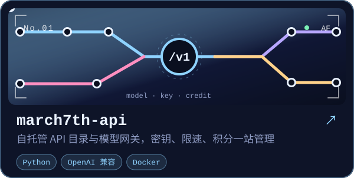
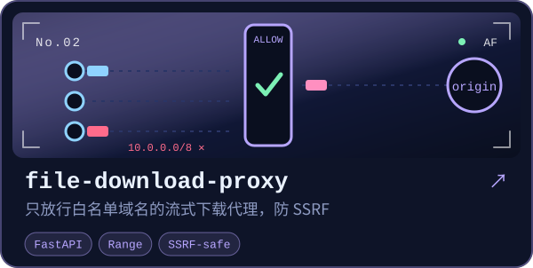
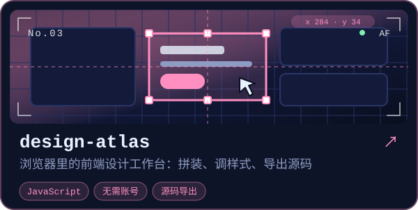
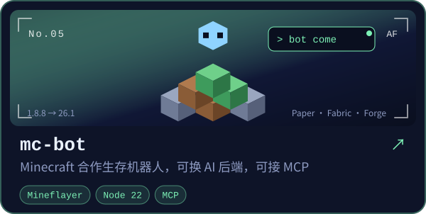
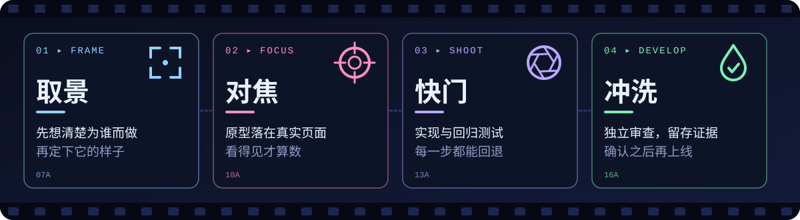

  

  <a href="https://march7th.cn"><b>主题站点</b></a> ·
  <a href="https://github.com/orgs/March7thTeam/repositories"><b>全部仓库</b></a> ·
  <a href="https://github.com/March7thTeam/.github/blob/main/CONTRIBUTING.md"><b>参与贡献</b></a> ·
  <a href="https://github.com/March7thTeam/.github/blob/main/SECURITY.md"><b>安全报告</b></a>

  我们是一个做<b>实用工具</b>和<b>互动作品</b>的小团队：从 API 网关、文件分享，到可视化设计工作台、悬疑解谜和 Minecraft 机器人。 
  每个项目都有线上入口，也都写明了怎么跑、怎么验证、哪些边界我们不碰。

 

  

  
  
  
  
  
  

  
<b>纯文本导航 · 直接去玩 / 直接去看</b>

   

| 项目 | 在做什么 | 入口 |
| --- | --- | --- |
| [march7th-api](https://github.com/March7thTeam/march7th-api) | 自托管 API 目录、模型网关与密钥管理 | [api.march7th.cn](https://api.march7th.cn) |
| [file-download-proxy](https://github.com/March7thTeam/file-download-proxy) | 基于域名白名单的流式下载代理，支持 Range 请求 | [阅读文档](https://github.com/March7thTeam/file-download-proxy#readme) |
| [design-atlas](https://github.com/March7thTeam/design-atlas) | 浏览器里探索设计、拼装页面、调整样式并导出源码 | [打开工作台](https://design-atlas-gold.vercel.app/) |
| [fog-harbor-archive](https://github.com/March7thTeam/fog-harbor-archive) | 在港口调查室里修复线索、重建证据链的悬疑解谜游戏 | [进入雾港档案](https://fog-harbor-archive.luomo.moe) |
| [mc-bot](https://github.com/March7thTeam/mc-bot) | 基于 Mineflayer 的 Minecraft 合作生存机器人，支持可插拔 AI 后端、工作流与 MCP | [查看使用说明](https://github.com/March7thTeam/mc-bot#readme) |
| [March7th Paste 4.0](https://github.com/March7thTeam/CloudPaste/tree/main/march7th-paste) | 在线剪贴板与文件分享（Next.js + PostgreSQL） | [paste.march7th.cn](https://paste.march7th.cn) |

> [CloudPaste](https://github.com/March7thTeam/CloudPaste) 是 [ling-drag0n/CloudPaste](https://github.com/ling-drag0n/CloudPaste) 的分支，仓库内保留其 Cloudflare 版本文档，并新增 March7th Paste 4.0。原始项目及贡献者的署名与授权以其仓库为准。

 

  

  

我们认的几条规矩，都能在仓库里找到对应的证据：

- **能打开、能用，才算数**：每个项目都有可访问的线上入口或可复现的本地启动步骤，功能与维护状态以各仓库 README 为准。
- **默认收紧，再逐步放开**：下载代理只放行白名单并在 DNS 解析后拒绝内网目标；API 网关只开放登记过的 `/v1` 接口，其余路径一律拒绝。
- **结论要有证据**：mc-bot 用同一套 12 项检查在多个服务器类型和版本上逐一实测；雾港档案的每次升级都附检查记录与依赖审计。
- **改动可回退、旧数据不丢**：存档、报告和截图按版本递增保留，升级不覆盖原始记录。

**手上的工具箱**：`Python` · `FastAPI` · `Next.js 16` · `React 19` · `TypeScript` · `Node.js` · `Mineflayer` · `PostgreSQL` · `Docker` · `Vercel` · `Cloudflare` · `MCP`

 

  

- **遇到问题**：先查对应项目的 README 和已有 Issues，再提供版本、复现步骤及脱敏日志。
- **有新想法**：在对应仓库提出建议；较大的改动先讨论目标和范围。
- **想改代码或文档**：阅读[贡献指南](https://github.com/March7thTeam/.github/blob/main/CONTRIBUTING.md)，提交聚焦的 Pull Request。
- **发现安全问题**：阅读[安全报告指引](https://github.com/March7thTeam/.github/blob/main/SECURITY.md)，通过受影响仓库的私密报告入口联系维护者。

中文与 English 均可。请尊重彼此，也请勿公开密钥、个人信息或未经脱敏的生产日志。

 

  

March7thTeam 是独立的项目协作组织，与 HoYoverse / 米哈游无隶属关系。页面中的相机、冰晶等图形均为原创矢量绘制，不含官方美术素材。代码与素材的使用须遵循各仓库的许可证及第三方授权说明。主页素材由 <code>scripts/build-profile-assets.mjs</code> 生成。
